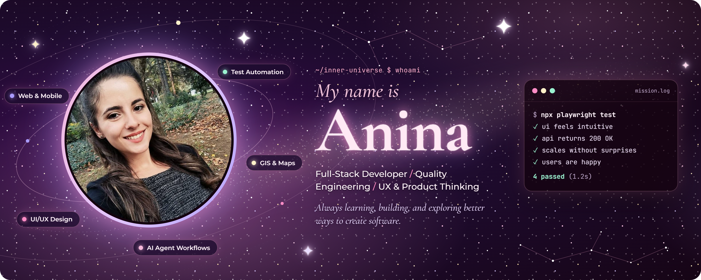

  

  

I build modern web and mobile applications, combining software engineering, test automation, and user-centered design to create reliable, intuitive, and scalable software solutions.

## 🛠️ Tech Stack

  

<b>🔍 Full tech stack by category</b>

 

**Languages & Core Technologies**  

**Frontend & Mobile**  

**Backend & Databases**  

**Validation & Data Integrity**  

**Testing & API**  

**DevOps, Deployment & Development Tools**  

**Design & Specialized Technologies**  

## 🚀 What I Do

<b>💻 Development</b>

 

- Building frontend and backend applications.
- Developing web and mobile experiences.
- Designing REST APIs and working with databases.

<b>🧪 Quality Engineering & Data Quality Assurance</b>

 

- Building end-to-end test automation frameworks.
- API testing and validation.
- Test architecture, maintainability, and software quality.
- Data transformation validation and regression testing.

<b>🎨 UX & Product Thinking</b>

 

- UX research and design thinking.
- UI/UX and design systems.
- User-centered development and performance optimization.

<b>🤖 AI-Assisted Development & Agent Engineering</b>

 

- AI-powered software development with Claude Code.
- AI-assisted design with Claude Design.
- Context Engineering & AI Environment Configuration.
- AI Agent Orchestration & Agentic Workflows.
- MCP Integrations.
- Prompt Engineering.

**Tools:** Claude Code · Claude Design · MCP · AI Agent Workflows

<b>🗺️ GIS & Geospatial Application Development</b>

 

- Interactive Map Development.
- Custom Map Layers & Layer Management.
- Leaflet & OpenStreetMap.
- PostGIS & Spatial Databases.
- Geospatial Data Visualization.
- ArcGIS Maps SDK for JavaScript & ArcGIS REST APIs.
- Calcite Design System.

---

💡 Always learning, building, and exploring better ways to create software.
